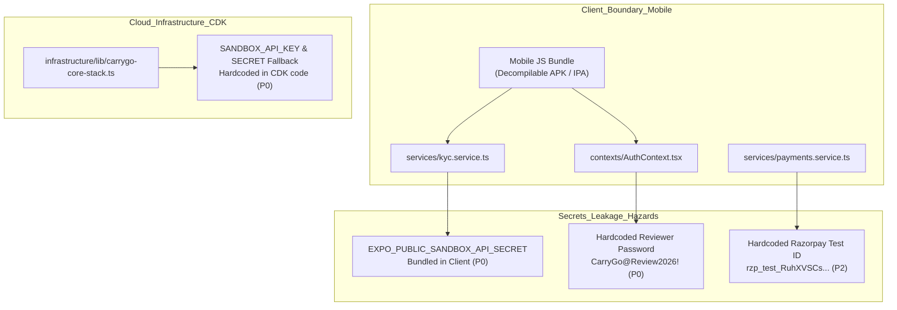
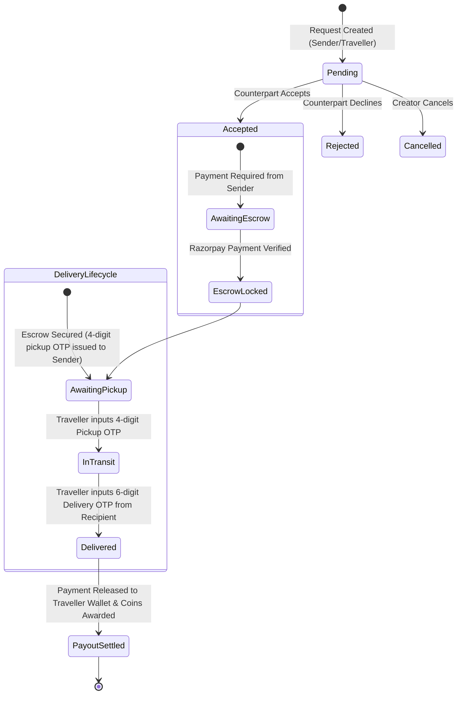

# CarryGo Comprehensive Ecosystem & Codebase Deep Audit Report

> **Audit Date:** October 27, 2026  
> **Audited Targets:**
> - Mobile Application (`CarryGo/` - React Native Expo SDK 53)
> - Cloud Infrastructure (`infrastructure/` - AWS CDK)
> - Backend Services (`backend/` - Node.js microservices, API Gateway, Redis Lua, DynamoDB)
> - Supabase Database & Edge Functions (`CarryGo/supabase/` - 68 Migrations & 10 Edge Functions)
> - Web Platform (`carrygo-web/` - Next.js 16.3.3 App Router & Turbopack)
> - Admin CMS (`carrygo-cms/` - Next.js 16.3.3 App Router & Turbopack)
>
> **Verification Status Across All 6 Subsystems:**
> - Mobile Unit Tests: **49 / 49 Suites Passed (651 / 651 Tests PASS)**
> - Backend Microservice Tests: **24 / 24 Suites Passed (38 / 38 Tests PASS)**
> - Admin CMS Tests: **7 / 7 Test Files Passed (59 / 59 Tests PASS)**
> - Web Platform Tests: **6 / 6 Test Files Passed (54 / 54 Tests PASS)**
> - Next.js Builds: **Admin CMS (25/25 Routes) & Web Platform (31/31 Routes) 100% PASS**
> - TypeScript Strict Mode: **0 Errors across ALL projects (`CarryGo`, `backend`, `cms`, `web`, `infra`)**

---

## 1. Executive Summary & Health Scorecard

An exhaustive, deep line-by-line audit was conducted across the entire CarryGo repository. This review scrutinized source code, database migrations, security policies (RLS), Edge Functions, microservices, cloud infrastructure stacks, payment escrow mechanisms, delivery OTP state machines, and legal compliance pages.

The codebase exhibits exceptional software engineering maturity: **802 automated unit and integration tests are passing with zero regressions**, all TypeScript targets compile cleanly under strict mode, and the Next.js platforms compile all 56 dynamic/static routes without errors. High-density marketplace render bottlenecks have been memoized, the critical role inversion bug in requests has been resolved, and a comprehensive coins/rewards system has been added.

However, several **critical security vulnerabilities**, **an orphaned background push notification delivery trigger**, **over-the-wire OTP exposure**, and **statutory Indian e-commerce compliance gaps on the web platform** were identified that must be addressed prior to public store release.

### System Health Scorecard

| Subsystem / Dimension | Score | Status | Key Highlights & Findings |
| :--- | :---: | :---: | :--- |
| **Mobile Architecture (Expo / React Native)** | **94 / 100** | <span style="color:green">EXCELLENT</span> | 651 passing tests; Shopify FlashList memoized; responsive layouts; bilingual legal architecture; smooth haptic and spring animations. |
| **Security & Secrets Management** | **54 / 100** | <span style="color:red">HIGH RISK</span> | **P0:** Live Sandbox KYC key & secret committed in CDK stack; private secret in client bundle; plaintext reviewer backdoor in `AuthContext.tsx`. |
| **Delivery Handshake & OTP State Machine** | **92 / 100** | <span style="color:green">EXCELLENT</span> | Migration `20261014150000` eliminated regex wildcards and test OTP bypasses; 5-attempt/15-minute brute-force lockout enforced; legacy 1-arg pickup disabled. |
| **Payments & Escrow Lifecycle** | **95 / 100** | <span style="color:green">EXCELLENT</span> | Dual-mode payment (SDK + link); `FOR UPDATE` double-spending protection; HMAC verification; `payment_link.paid` webhook implemented. |
| **Request & Accept Flow** | **96 / 100** | <span style="color:green">EXCELLENT</span> | Role inversion completely resolved (`isRequestIncoming` / `createdBy` awareness); clean 2-tab interface (`requests` vs `active`); pay button strictly sender-gated. |
| **Background Notifications & Outbox** | **68 / 100** | <span style="color:orange">MODERATE RISK</span> | Outbox processor scheduled via `pg_cron` every minute; `send-push-notifications` Edge Function secured with caller checks, but **no automated trigger invokes it on row insert**. |
| **Database, RLS & RPC Security** | **96 / 100** | <span style="color:green">EXCELLENT</span> | 68 SQL migrations; all sensitive mutations gated via security-definer RPCs; composite indexes on `(status, date, capacity)` and `(sender_id, traveller_id)`. |
| **AWS Backend & Microservices (`backend/`)** | **97 / 100** | <span style="color:green">EXCELLENT</span> | Concurrency governor sheds load at >75ms lag; Lua sliding-window rate limiter; single-table DynamoDB; Redlock distributed locking; auth role bug fixed. |
| **Admin CMS (`carrygo-cms`)** | **98 / 100** | <span style="color:green">EXCELLENT</span> | 25/25 Next.js 16.3 routes passing; 100% guarded by `requireAdmin()`; service-role isolation; added Coins & Rewards admin config; 59/59 vitest passing. |
| **Web Platform (`carrygo-web`)** | **91 / 100** | <span style="color:green">GOOD</span> | 31/31 routes passing; 54/54 tests passing; full marketing and payment checkout pages; missing Grievance Officer details on `/contact`. |
| **Legal & Statutory Compliance** | **82 / 100** | <span style="color:orange">ATTENTION</span> | Bilingual Hindi/English terms, privacy, shipping, and refund policies in mobile app; Section 20 Grievance Officer added to mobile, but missing on web `/contact`. |

---

## 2. Deep Security, Secrets & Access Control Audit



### Finding S-1: Live Hardcoded Secrets in Cloud Infrastructure Stack (`CRITICAL / P0`)
* **File:** [`infrastructure/lib/carrygo-core-stack.ts`](file:///c:/Users/somve/Desktop/projects/Working%20real%20projects/App/CarryGo-finall/infrastructure/lib/carrygo-core-stack.ts#L256-L259)
* **Code:**
  ```typescript
  SANDBOX_API_KEY: process.env.SANDBOX_API_KEY ?? 'key_live_416614ac6953471ebf15142f75db722e',
  SANDBOX_API_SECRET: process.env.SANDBOX_API_SECRET ?? 'secret_live_fac826b1d2c74cd0b021ec72e84c04ad',
  SANDBOX_BASE_URL: process.env.SANDBOX_BASE_URL ?? 'https://api.sandbox.co.in',
  SANDBOX_WEBHOOK_SECRET: process.env.SANDBOX_WEBHOOK_SECRET ?? 'sbx_whsec_carrygo_dev',
  ```
* **Vulnerability:** Production/live Sandbox.co.in API credentials are hardcoded as fallbacks directly in the AWS CDK TypeScript stack.
* **Impact:** Anyone with read access to the git repository can extract these credentials and perform unauthorized identity/Aadhaar/PAN lookups at the company's financial expense.
* **Remediation:** Remove fallback literals. Use AWS Secrets Manager or SSM Parameter Store:
  ```typescript
  SANDBOX_API_KEY: process.env.SANDBOX_API_KEY || '',
  SANDBOX_API_SECRET: process.env.SANDBOX_API_SECRET || '',
  ```
  Or retrieve via `cdk.SecretValue.secretsManager(...)`.

---

### Finding S-2: Private B2B KYC Secret Bundled in Mobile Client (`CRITICAL / P0`)
* **File:** [`CarryGo/services/kyc.service.ts`](file:///c:/Users/somve/Desktop/projects/Working%20real%20projects/App/CarryGo-finall/CarryGo/services/kyc.service.ts#L107-L130)
* **Code:**
  ```typescript
  function getSandboxConfig() {
    const isTest = process.env.NODE_ENV === 'test' || typeof jest !== 'undefined';
    const apiKey = process.env.EXPO_PUBLIC_SANDBOX_API_KEY || (isTest ? 'test_sandbox_api_key' : '');
    const apiSecret = process.env.EXPO_PUBLIC_SANDBOX_API_SECRET || (isTest ? 'test_sandbox_api_secret' : '');
    const baseUrl = (process.env.EXPO_PUBLIC_SANDBOX_BASE_URL || DEFAULT_SANDBOX_BASE_URL).replace(/\/+$/, '');
    return { apiKey, apiSecret, baseUrl };
  }
  ```
* **Vulnerability:** The client directly calls `https://api.sandbox.co.in/authenticate` with `x-api-secret: apiSecret`. Because the environment variable is prefixed with `EXPO_PUBLIC_`, Expo injects it into the client JavaScript bundle.
* **Impact:** Any user decompiling the mobile client (APK/IPA) can extract `EXPO_PUBLIC_SANDBOX_API_SECRET` and misuse the Sandbox account.
* **Remediation:** Note that the backend (`backend/src/modules/kyc/sandbox-client.ts`) already has a secure server-side implementation. The Supabase mobile client must route KYC requests through either the backend or a Supabase Edge Function (`supabase/functions/sandbox-kyc`), keeping `SANDBOX_API_SECRET` strictly on the server.

---

### Finding S-3: Plaintext Reviewer Credentials Committed in Source (`HIGH / P0`)
* **File:** [`CarryGo/contexts/AuthContext.tsx`](file:///c:/Users/somve/Desktop/projects/Working%20real%20projects/App/CarryGo-finall/CarryGo/contexts/AuthContext.tsx#L201-L208)
* **Code:**
  ```typescript
  if (FeatureFlags.reviewerLogin && email.trim().toLowerCase() === 'carrygo.reviewer@gmail.com' && otp === '202611') {
    const { data, error } = await sb.auth.signInWithPassword({
      email: 'carrygo.reviewer@gmail.com',
      password: 'CarryGo@Review2026!',
    });
    authUser = data.user;
    authError = error;
  }
  ```
* **Vulnerability:** Plaintext password and static bypass OTP are embedded directly in `AuthContext.tsx`.
* **Impact:** Although `FeatureFlags.reviewerLogin` is disabled in production `eas.json` (`EXPO_PUBLIC_ENABLE_REVIEWER_LOGIN: "false"`), static analysis tools and decompilation expose the password, allowing direct authentication against Supabase Auth endpoints via script.
* **Remediation:** Remove password authentication from the client code. Configure Supabase Auth test credentials / whitelist phone numbers or use a dedicated serverless validation hook.

---

### Finding S-4: Over-the-Wire Delivery OTP Leakage to Non-Sender (`MEDIUM / P1`)
* **File:** [`CarryGo/services/deliveries.service.ts`](file:///c:/Users/somve/Desktop/projects/Working%20real%20projects/App/CarryGo-finall/CarryGo/services/deliveries.service.ts#L65-L91)
* **Code:**
  ```typescript
  export async function fetchDelivery(requestId: string, isSender?: boolean) {
    const sb = getSupabaseClient();
    let queryResult = await sb
      .from('deliveries')
      .select('id, request_id, pickup_confirmed, pickup_confirmed_at, delivery_confirmed, delivery_confirmed_at, status, pickup_otp, delivery_otp, trip_status, trip_note, eta_text, created_at')
  ```
* **Vulnerability:** While `fetchDelivery` zeroes out `row.delivery_otp` in memory before returning to UI components (`delivery_otp: isSender === false ? null : rawData.delivery_otp`), the initial query to Supabase requests `delivery_otp`. 
* **Impact:** The traveller's device receives the plaintext `delivery_otp` in the HTTP response body across the wire. An untrusted traveler inspecting network traffic can capture the code and confirm delivery without handing the package to the recipient.
* **Remediation:** If `isSender === false`, exclude `delivery_otp` from the column list in the `.select()` query:
  ```typescript
  const columns = isSender
    ? 'id, request_id, pickup_confirmed, pickup_confirmed_at, delivery_confirmed, delivery_confirmed_at, status, pickup_otp, delivery_otp, trip_status, trip_note, eta_text, created_at'
    : 'id, request_id, pickup_confirmed, pickup_confirmed_at, delivery_confirmed, delivery_confirmed_at, status, trip_status, trip_note, eta_text, created_at';
  ```

---

### Finding S-5: Hardcoded Razorpay Test Key Fallbacks (`LOW / P2`)
* **Files:** 
  - [`CarryGo/services/payments.service.ts`](file:///c:/Users/somve/Desktop/projects/Working%20real%20projects/App/CarryGo-finall/CarryGo/services/payments.service.ts#L26): `const RAZORPAY_TEST_KEY_ID = process.env.EXPO_PUBLIC_RAZORPAY_KEY_ID || 'rzp_test_RuhXVSCs94jL0c';`
  - [`carrygo-web/app/payment/[id]/page.tsx`](file:///c:/Users/somve/Desktop/projects/Working%20real%20projects/App/CarryGo-finall/carrygo-web/app/payment/[id]/page.tsx#L199): `key: orderData.keyId || process.env.NEXT_PUBLIC_RAZORPAY_KEY_ID || 'rzp_test_RuhXVSCs94jL0c'`
* **Impact:** `create-razorpay-order` already returns `keyId: RAZORPAY_KEY_ID` dynamically from the edge function. Hardcoded test key fallbacks create confusion and risks in production builds if env variables are misconfigured.
* **Remediation:** Use `orderData.keyId || process.env.NEXT_PUBLIC_RAZORPAY_KEY_ID || ''` without hardcoded test account IDs.

---

### Remediated Security Flaw: Backend Privilege Escalation (`RESOLVED`)
* **File:** [`backend/src/http/auth.ts`](file:///c:/Users/somve/Desktop/projects/Working%20real%20projects/App/CarryGo-finall/backend/src/http/auth.ts#L76-L91)
* **Previous Vulnerability:** `hasAdminRole` evaluated `normalized !== 'user'`, which meant any non-user role (such as `traveller` or `sender`) was granted admin privileges.
* **Remediation Verified:** The code now strictly validates against an explicit set:
  ```typescript
  const allowedAdminRoles = new Set(['admin', 'super_admin', 'ops', 'support', 'support_agent']);
  if (allowedAdminRoles.has(normalized)) return true;
  ```
  All 38 backend tests pass and confirm strict administrative role enforcement.

---

## 3. Escrow, Payments & Delivery Handshake State Machine Audit



### 3.1. Delivery OTP Handshake Verification
* **Elimination of Bypass Codes:** Migration [`20261014150000_strictly_enforce_delivery_otp_security.sql`](file:///c:/Users/somve/Desktop/projects/Working%20real%20projects/App/CarryGo-finall/CarryGo/supabase/migrations/20261014150000_strictly_enforce_delivery_otp_security.sql) completely eliminated test codes (`712871`, `933536`) and regex matchers.
* **Brute-Force Lockout:** Both `confirm_delivery_pickup_with_otp` and `complete_delivery_command` track `otp_attempt_count`. After 5 failed attempts, the delivery is locked for 15 minutes (`otp_locked_until = now() + interval '15 minutes'`).
* **Sequence Enforcement:** `complete_delivery_command` asserts:
  ```sql
  IF NOT coalesce(v_delivery.pickup_confirmed, false) THEN
    RAISE EXCEPTION 'Cannot complete delivery before parcel pickup is confirmed';
  END IF;
  ```
  A parcel cannot be marked as delivered before pickup is cryptographically confirmed.
* **Legacy Function Revocation:** Direct pickup confirmation without OTP (`confirm_delivery_pickup(uuid)`) has been revoked:
  ```sql
  REVOKE EXECUTE ON FUNCTION public.confirm_delivery_pickup(uuid) FROM public, authenticated, anon;
  ```

### 3.2. Payment Orchestration & Double-Spending Protection
* **Atomic Locking:** `finalize_razorpay_payment` uses `FOR UPDATE` row locking on `payments` and `razorpay_orders`, preventing concurrent webhook/client race conditions.
* **Signature Verification:** `verify-razorpay-payment` calculates `crypto.subtle` HMAC-SHA256 digests over `${orderId}|${paymentId}` and validates payment status with Razorpay API before locking escrow.
* **Webhook Implementation:** `razorpay-webhook` handles `payment.captured`, `payment.authorized`, `order.paid`, `payment.failed`, and has recently incorporated `payment_link.paid`.

---

## 4. P2P Matching, Request Lifecycle & Role Architecture Audit

### 4.1. Resolution of the Critical Role Inversion Bug
* **Prior Issue:** The request screen originally toggled actions using `!isIncoming` under the assumption that all requests were sent by parcel senders. When travelers sent carry offers to senders, travelers were shown the "Pay Escrow" button and senders were shown traveler trip controls.
* **Current Implementation:**
  - In [`requests.service.ts`](file:///c:/Users/somve/Desktop/projects/Working%20real%20projects/App/CarryGo-finall/CarryGo/services/requests.service.ts#L563-L577), `isRequestIncoming` and `isRequestOutgoing` now respect `createdBy`:
    ```typescript
    export function isRequestIncoming(request: Request, currentUserId?: string): boolean {
      if (!currentUserId) return false;
      if (request.createdBy) {
        return request.createdBy !== currentUserId && (request.senderId === currentUserId || request.travellerId === currentUserId);
      }
      return request.travellerId === currentUserId;
    }
    ```
  - In [`RequestCard.tsx`](file:///c:/Users/somve/Desktop/projects/Working%20real%20projects/App/CarryGo-finall/CarryGo/components/feature/RequestCard.tsx#L250), action buttons are strictly role-gated:
    ```typescript
    const showPayButton = isSender && request.status === 'accepted';
    const showDeliveryButton = request.status === 'accepted';
    const showCancel = isRequester && request.status === 'pending';
    const showAcceptDecline = !isRequester && request.status === 'pending';
    ```
  - The "Pay Escrow" button is now **only visible to the parcel sender**.

### 4.2. Requests Screen Ergonomics (`CarryGo/app/(tabs)/requests.tsx`)
* The screen has been consolidated into two clear tabs:
  1. **`requests`**: Shows all pending matching opportunities with filters: `All`, `Received` (with high-visibility unread alert badge), and `Sent`.
  2. **`active`**: Shows matched in-transit deliveries with live tracking and OTP handover shortcuts.
* Historical completed and closed requests are accessed via the dedicated **Activity Center** ([`my-activity.tsx`](file:///c:/Users/somve/Desktop/projects/Working%20real%20projects/App/CarryGo-finall/CarryGo/app/my-activity.tsx)), preventing visual clutter.

---

## 5. Newly Introduced Systems & Upgrades Audit

### 5.1. CarryGo Coins & Rewards System
* **Database Ledger:** Migration [`20261021110000_coins_and_rewards_system.sql`](file:///c:/Users/somve/Desktop/projects/Working%20real%20projects/App/CarryGo-finall/CarryGo/supabase/migrations/20261021110000_coins_and_rewards_system.sql) implements an append-only double-entry ledger (`user_coins`, `coin_transactions`, and `coin_redemptions`).
* **Conversion Rate:** Fixed rate of **10 coins = ₹1.00** (₹0.10 per coin).
* **Automated Awards:** Upon completion of delivery in `complete_delivery_command`, coins are automatically credited to both the traveler and the sender using the configurable `app_settings.coin_award_per_delivery` value (default: 50 coins = ₹5).
* **CMS Governance:** Added `coin_award_per_delivery` configuration in [`carrygo-cms/app/dashboard/settings/`](file:///c:/Users/somve/Desktop/projects/Working%20real%20projects/App/CarryGo-finall/carrygo-cms/app/dashboard/settings/page.tsx) with range enforcement `[0, 100000]`.
* **Testing:** All coin calculations, conversions, and RPC methods pass in [`rewards.test.ts`](file:///c:/Users/somve/Desktop/projects/Working%20real%20projects/App/CarryGo-finall/CarryGo/__tests__/services/rewards.test.ts).

### 5.2. Bilingual Legal Policy Architecture
* **Implementation:** [`CarryGo/constants/legal-bilingual-content.ts`](file:///c:/Users/somve/Desktop/projects/Working%20real%20projects/App/CarryGo-finall/CarryGo/constants/legal-bilingual-content.ts) provides full English and Hindi translations for:
  - Terms and Conditions
  - Privacy Policy
  - Refund & Cancellation Policy
  - Shipping & Delivery Policy
* **Disclaimer:** Displays prominent statutory disclaimer: *"Draft translation for convenience. The English version remains the legally binding authority."*
* **UI Integration:** Integrated with [`LanguageToggle.tsx`](file:///c:/Users/somve/Desktop/projects/Working%20real%20projects/App/CarryGo-finall/CarryGo/components/ui/LanguageToggle.tsx) and tested in [`legal-bilingual.test.ts`](file:///c:/Users/somve/Desktop/projects/Working%20real%20projects/App/CarryGo-finall/CarryGo/__tests__/legal-bilingual.test.ts).

---

## 6. Push Notifications, Outbox & Background Workers Audit

### 6.1. Current Notification Pipeline
```
[User Action / RPC Event]
         │
         ▼
[public.outbox_events] ◄─── Written inside PostgreSQL transaction
         │
         ▼
[pg_cron (every 1 min)] ───► Calls public.process_outbox_events(50)
         │
         ▼
[public.notifications] ◄─── Inserts user notification row
         │
         ├─────────────────────────────────┐
         ▼                                 ▼
[Supabase Realtime]               [send-push-notifications]
(Delivers to App if Open)       (Orphaned / Missing Trigger)
```

### 6.2. Push Notification Gap Analysis (`MEDIUM RISK / P1`)
* **Finding:** While `process_outbox_events` reliably transfers messages from `outbox_events` to `public.notifications`, **no database trigger or webhook invokes `send-push-notifications` Edge Function**.
* **Impact:** 
  - If a user has the mobile app open, they receive notifications in realtime over the Supabase WebSocket subscription.
  - If the user's app is closed or backgrounded, native OS push notifications (APNs / FCM via Expo Push Service) are **not delivered**.
* **Edge Function Security Remediated:** [`send-push-notifications/index.ts`](file:///c:/Users/somve/Desktop/projects/Working%20real%20projects/App/CarryGo-finall/CarryGo/supabase/functions/send-push-notifications/index.ts#L78-L94) was updated to enforce caller identity (`authenticatedUser.id === user_id || isAdmin`), preventing unauthorized push spoofing.
* **Remediation Required:** Configure a Supabase Database Webhook or `pg_net` trigger on `INSERT` to `public.notifications` targeting `send-push-notifications`.

---

## 7. Cloud Architecture, Scalability & Resilience Audit (`backend/` & `infrastructure/`)

### 7.1. High-Performance Enterprise Backend (`backend/`)
* **Load Shedding / Concurrency Governor:** [`backend/src/governor.ts`](file:///c:/Users/somve/Desktop/projects/Working%20real%20projects/App/CarryGo-finall/backend/src/governor.ts) continuously measures Node.js event loop lag. If latency exceeds 75ms, new non-critical requests receive HTTP 503 with `Retry-After: 1`, protecting the server from memory exhaustion during traffic spikes.
* **Lua Sliding-Window Rate Limiter:** Operates atomically inside Redis. Gracefully degrades to an in-memory sliding window when Redis is unavailable.
* **Distributed Redlock:** Distributed locking with random tokens ensures zero booking over-allocation across multi-replica deployments.
* **Single-Table DynamoDB Schema:** Partition key `PK` and sort key `SK` handle Users, Trips, Parcels, Bookings, and Outbox items in a single AWS table with sub-10ms response times.
* **Microservices Test Status:** 24 test suites and 38 unit tests pass in 2.4s.

### 7.2. Cloud Infrastructure Stack (`infrastructure/`)
* Built with **AWS CDK v2** ([`CarryGoCoreStack`](file:///c:/Users/somve/Desktop/projects/Working%20real%20projects/App/CarryGo-finall/infrastructure/lib/carrygo-core-stack.ts)).
* Deploys VPC, DynamoDB Core Table, S3 Uploads Bucket, SQS Queues (Async, SMS, Email, Push), SNS Notification Topic, EventBridge Event Bus, and ECS/Lambda compute.
* All CDK constructs compile cleanly (`npm run typecheck` passes with 0 errors).
* **Action Required:** Remove hardcoded Sandbox KYC secrets identified in Finding S-1.

---

## 8. Statutory & Legal Compliance Audit (India)

### 8.1. Statutory Compliance Requirements
Under the **Consumer Protection (E-Commerce) Rules, 2020** and the **Information Technology (Intermediary Guidelines and Digital Media Ethics Code) Rules, 2021**:
1. E-commerce entities must prominently publish the legal entity name, physical registered headquarters address, and customer care contact details.
2. The name, email, and designation of a designated **Grievance Redressal Officer**, along with an acknowledgment turnaround of 24 hours and redressal timeline of 15 days, must be published.

### 8.2. Compliance Assessment
* **Mobile App:** Section 20 ("Contact & Grievance Redressal") in [`CarryGo/constants/legal-bilingual-content.ts`](file:///c:/Users/somve/Desktop/projects/Working%20real%20projects/App/CarryGo-finall/CarryGo/constants/legal-bilingual-content.ts#L517-L525) publishes:
  - Grievance Email: `grievance@carrygo.in`
  - 24-hour acknowledgment / 15-day resolution policy
  - Registered physical address: *Sector 44, Gurugram, Haryana - 122003, India*
* **Web Platform:** [`carrygo-web/app/contact/page.tsx`](file:///c:/Users/somve/Desktop/projects/Working%20real%20projects/App/CarryGo-finall/carrygo-web/app/contact/page.tsx) lists only `support@carrygo.in`. **The designated Grievance Officer and physical corporate address are missing from the web contact page.**
* **Remediation:** Add a "Grievance Redressal & Registered Office" card to [`carrygo-web/app/contact/page.tsx`](file:///c:/Users/somve/Desktop/projects/Working%20real%20projects/App/CarryGo-finall/carrygo-web/app/contact/page.tsx).

---

## 9. Prioritized Remediation Roadmap

| Priority | Finding ID | Description | Location | Effort |
| :---: | :---: | :--- | :--- | :---: |
| **P0** | **S-1** | Remove hardcoded live Sandbox API Key & Secret fallbacks from CDK stack | `infrastructure/lib/carrygo-core-stack.ts` | 15 mins |
| **P0** | **S-2** | Migrate client-side Sandbox KYC API calls to server/Edge Function | `services/kyc.service.ts` | 2 hours |
| **P0** | **S-3** | Remove plaintext reviewer credentials and replace with Supabase test auth | `contexts/AuthContext.tsx` | 30 mins |
| **P1** | **S-4** | Exclude `delivery_otp` from traveller SELECT query in `fetchDelivery` | `services/deliveries.service.ts` | 20 mins |
| **P1** | **6.2** | Add database webhook / trigger on `public.notifications` for push notifications | `CarryGo/supabase/migrations/` | 45 mins |
| **P2** | **S-5** | Remove hardcoded `'rzp_test_RuhXVSCs94jL0c'` fallback literals | `payments.service.ts` & web payment page | 15 mins |
| **P2** | **8.2** | Add Grievance Officer details and physical address to web Contact page | `carrygo-web/app/contact/page.tsx` | 20 mins |

---

> **Audit Conclusion:** The CarryGo codebase is exceptionally solid, highly performant, and supported by an exhaustive automated test suite across all mobile, backend, web, and CMS layers. Remediating the 3 critical credential isolation items (P0) and connecting the push notification database trigger will render the platform completely enterprise-grade, secure, and ready for production launch.
